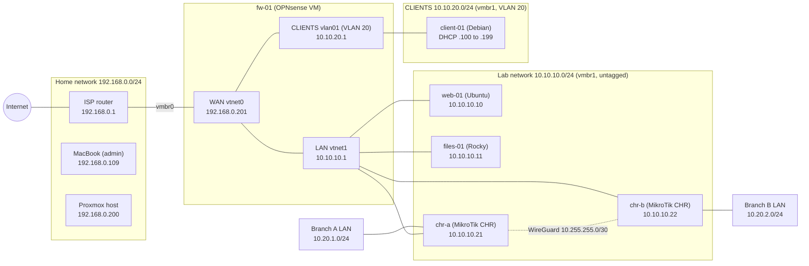

# Network

The lab has its own network, `10.10.10.0/24`, behind an OPNsense VM (`fw-01`), plus a clients VLAN (`10.10.20.0/24`) on the same bridge and two simulated branch offices joined by a WireGuard tunnel. The home network doesn't change and doesn't depend on the lab: with `fw-01` off, the house still has internet. How it was built and tested: [writeup 02](../writeups/02-opnsense-isolated-lab.md) (the lab network), [writeup 06](../writeups/06-vlans-and-firewall-rules.md) (the clients VLAN) and [writeup 07](../writeups/07-site-to-site-wireguard-mikrotik.md) (the branches).



## Home network: `192.168.0.0/24`

| Address | Device |
| --- | --- |
| `192.168.0.1` | ISP router (Technicolor CGA4233), gateway |
| `192.168.0.2`–`.199` | The router's DHCP range |
| `192.168.0.109` | MacBook (admin machine), reserved on the router |
| `192.168.0.200` | Proxmox host (`pve.home.arpa`) |
| `192.168.0.201` | `fw-01` WAN |

Static addresses go from `.200` up, outside the router's DHCP range.

## Lab network: `10.10.10.0/24`

| Address | Use |
| --- | --- |
| `10.10.10.1` | `fw-01` LAN: gateway, DNS and DHCP for the lab |
| `10.10.10.2`–`.99` | Static IPs: `web-01` (`.10`), `files-01` (`.11`), `chr-a` (`.21`) and `chr-b` (`.22`) |
| `10.10.10.100`–`.199` | DHCP |
| `10.10.10.200`–`.254` | Free |

Domain: `lab.home.arpa`.

### Guests

| Name | Proxmox ID | System | Address | Offers | Host firewall |
| --- | --- | --- | --- | --- | --- |
| `fw-01` | VM 100 | OPNsense 26.7.5 | `10.10.10.1` | Gateway, DNS, DHCP | It is the firewall |
| `web-01` | VM 110 | Ubuntu Server 26.04.1 LTS | `10.10.10.10` | SSH, HTTP (nginx) | `ufw`: OpenSSH, Nginx HTTP |
| `files-01` | VM 111 | Rocky Linux 10.2 | `10.10.10.11` | SSH, SMB (Samba share `shared`) | `firewalld`: ssh, samba |
| `chr-a` | VM 121 | MikroTik RouterOS 7.24.5 (CHR, free license) | `10.10.10.21` | Branch A's router: SSH, WinBox, WireGuard | None yet |
| `chr-b` | VM 122 | MikroTik RouterOS 7.24.5 (CHR, free license) | `10.10.10.22` | Branch B's router: SSH, WinBox, WireGuard | None yet |
| `client-01` | CT 201 | Debian 13 | `10.10.20.194` (DHCP, on `CLIENTS`) | Nothing: a test client | None |

The servers were built in [writeup 03](../writeups/03-linux-server-baseline.md), with their services in [writeup 04](../writeups/04-samba-vs-selinux.md) and [writeup 05](../writeups/05-vm-backup-and-restore.md). `client-01` is from [writeup 06](../writeups/06-vlans-and-firewall-rules.md), and the routers from [writeup 07](../writeups/07-site-to-site-wireguard-mikrotik.md).

### Host entries in Dnsmasq

Dnsmasq only registers the machines it gives addresses to, so the servers with static IPs are added by hand in Services → Dnsmasq DNS & DHCP → Hosts:

| Host | Domain | IP address |
| --- | --- | --- |
| `web-01` | `lab.home.arpa` | `10.10.10.10` |
| `files-01` | `lab.home.arpa` | `10.10.10.11` |

## Clients VLAN: `10.10.20.0/24`

VLAN 20 on `vmbr1`, called `CLIENTS` in OPNsense. For user devices: they can use `web-01`'s website and the internet, and nothing else private.

| Address | Use |
| --- | --- |
| `10.10.20.1` | `fw-01` on `CLIENTS` (`vlan01`): gateway, DNS and DHCP for the VLAN |
| `10.10.20.2`–`.99` | Free, for static IPs |
| `10.10.20.100`–`.199` | DHCP. `client-01` has `.194` |
| `10.10.20.200`–`.254` | Free |

## Branch networks

Two simulated branch offices, each behind a MikroTik CHR on the lab network. The lab network plays the internet between them.

| Network | Where | Use |
| --- | --- | --- |
| `10.20.1.0/24` | `branch-lan` on `chr-a` (`10.20.1.1`) | Branch A's LAN, a bridge with no ports |
| `10.20.2.0/24` | `branch-lan` on `chr-b` (`10.20.2.1`) | Branch B's LAN, a bridge with no ports |
| `10.255.255.0/30` | `wg-site-to-site` on both (`.1` on `chr-a`, `.2` on `chr-b`) | The WireGuard tunnel, UDP 13231 between `10.10.10.21` and `.22` |

Each router has a static route to the other branch's LAN through the tunnel, and its default route through `fw-01`. The tunnel goes directly between the two routers on `vmbr1`, so it never reaches `fw-01`.

## Proxmox bridges

| Bridge | Physical port | Host IP | What connects to it |
| --- | --- | --- | --- |
| `vmbr0` | `nic0` | `192.168.0.200/24` | The home network, and `fw-01`'s WAN (`net0`) |
| `vmbr1` | None | None | The lab: `fw-01`'s LAN (`net1`) and every lab machine. VLAN aware: the lab network travels untagged, `CLIENTS` as VLAN 20 |

Lab machines connect only to `vmbr1`. Anything on `vmbr0` is on the home network and doesn't go through the firewall.

`fw-01`'s `net1` has no VLAN tag, so it's a trunk: it gets the lab network untagged and every VLAN tagged. `client-01`'s card has tag 20, so it's an access port in `CLIENTS` and never sees a tag.

## `fw-01`

| | |
| --- | --- |
| Product | OPNsense 26.7.5 |
| VM | ID 100, 2 vCPUs, 2 GB RAM, 20 GB disk, starts at boot (order 1) |
| WAN | `vtnet0` (Proxmox `net0`), `192.168.0.201/24`, gateway `192.168.0.1` |
| LAN | `vtnet1` (Proxmox `net1`), `10.10.10.1/24` |
| CLIENTS | `vlan01` (VLAN 20 on `vtnet1`, identifier `opt1`), `10.10.20.1/24`, IPv4 gateway rules disabled |
| Web interface | `https://10.10.10.1`, from the Mac with `labup` |

| Service | Configuration |
| --- | --- |
| DNS | Unbound on port 53 on every interface, recursive (no forwarders), with DNSSEC validation. Queries for `lab.home.arpa` go to Dnsmasq |
| DHCP | Dnsmasq on the LAN (`10.10.10.100`–`.199`) and on `CLIENTS` (`10.10.20.100`–`.199`). Registers DHCP hostnames in `lab.home.arpa`, plus host entries for the servers with static IPs |
| NAT | Source NAT (*Outbound* before OPNsense 26.7), automatic mode: traffic from the lab and from `CLIENTS` leaves with `192.168.0.201` |
| Reply-to | Off (see [decisions](decisions.md#reply-to-off)) |

## Aliases

| Name | Type | Content |
| --- | --- | --- |
| `HOME_NET` | Network(s) | `192.168.0.0/24` |
| `ADMIN_MAC` | Host(s) | `192.168.0.109` |
| `PRIVATE_NETS` | Network(s) | `10.0.0.0/8`, `172.16.0.0/12`, `192.168.0.0/16` |
| `WEB_01` | Host(s) | `10.10.10.10` |
| `WEB_PORTS` | Port(s) | `80`, `443` |

## Firewall rules

Rules are checked by Sequence, lowest first, and the first match wins.

**WAN**

| Sequence | Action | Version | Source | Destination | Log | Description |
| --- | --- | --- | --- | --- | --- | --- |
| 111 | Pass | IPv4 | `ADMIN_MAC` | LAN net | No | `Allow admin Mac to lab` (Disable reply-to checked) |
| — | Block | | Anything else | | | OPNsense's default block on the WAN |

**LAN**

| Sequence | Action | Version | Source | Destination | Log | Description |
| --- | --- | --- | --- | --- | --- | --- |
| 10 | Block | IPv4 | LAN net | `HOME_NET` | Yes | `Block lab to home network` |
| 20 | Pass | IPv4 | LAN net | any | No | `Default allow LAN to any rule` |
| 21 | Pass | IPv6 | LAN net | any | No | `Default allow LAN IPv6 to any rule` |

**CLIENTS**

| Sequence | Action | Version | Protocol | Source | Destination | Destination port | Log | Description |
| --- | --- | --- | --- | --- | --- | --- | --- | --- |
| 10 | Pass | IPv4 | TCP/UDP | CLIENTS net | CLIENTS address | 53 | No | `Allow clients DNS to firewall` |
| 20 | Pass | IPv4 | TCP | CLIENTS net | `WEB_01` | `WEB_PORTS` | No | `Allow clients to web-01 HTTP` |
| 30 | Block | IPv4 | any | CLIENTS net | `PRIVATE_NETS` | any | Yes | `Block clients to private networks` |
| 40 | Pass | IPv4 | any | CLIENTS net | any | any | No | `Allow clients to internet` |
| — | Block | | | Anything else | | | | OPNsense's default block |

DHCP on `CLIENTS` needs no rule of mine: the request comes from `0.0.0.0`, and OPNsense lets DHCP through to its own server on the interfaces where it runs.

## What can talk to what

| Traffic | Result |
| --- | --- |
| Mac → lab | Allowed (WAN rule, only from `192.168.0.109`). On the servers, their own firewalls allow SSH to both, HTTP to `web-01` and SMB to `files-01` |
| Lab → internet | Allowed (default LAN rule and NAT) |
| Lab → home network | Blocked and logged |
| Other home devices → lab | Blocked (no WAN rule matches) |
| Lab machine ↔ lab machine | Never reaches `fw-01`: same network. Only each server's own firewall filters it |
| `CLIENTS` → `fw-01`'s DNS | Allowed (rule 10) |
| `CLIENTS` → `web-01` on ports 80 and 443 | Allowed (rule 20) |
| `CLIENTS` → anything else private (servers' other ports, `fw-01`'s web interface, the house, the branches) | Blocked and logged (rule 30) |
| `CLIENTS` → internet | Allowed (rule 40 and NAT) |
| Lab → `CLIENTS` | Allowed by the default LAN rule. Nothing needs it; a candidate for a block |
| Mac → `CLIENTS` | No route and no rule. `client-01` is managed with `pct enter 201` |
| Branch A LAN ↔ branch B LAN | Through the WireGuard tunnel between `chr-a` and `chr-b`. Never reaches `fw-01` |

Replies always get back: the firewall is stateful, so the answers to a connection the Mac opened aren't checked against the LAN block.

## Reaching the lab from the Mac

The home router doesn't know about `10.10.10.0/24`, so the Mac needs a route through `fw-01`. Two aliases in `~/.zshrc`:

```bash
alias labup='sudo route -n add -net 10.10.10.0/24 192.168.0.201'
alias labdown='sudo route -n delete -net 10.10.10.0/24'
```

Check with `route -n get 10.10.10.1`: it must say `gateway: 192.168.0.201`.

The Mac uses my ISP's DNS servers, which don't know `lab.home.arpa`, so `~/.ssh/config` has the servers by IP:

```text
Host web-01
    HostName 10.10.10.10
Host files-01
    HostName 10.10.10.11
Host web-01 files-01
    User nico
    IdentityFile ~/.ssh/id_ed25519
    IdentitiesOnly yes
    AddKeysToAgent yes
    UseKeychain yes

Host chr-a
    HostName 10.10.10.21
Host chr-b
    HostName 10.10.10.22
Host chr-a chr-b
    User nico
    IdentityFile ~/.ssh/id_ed25519
    IdentitiesOnly yes
```

For a console that doesn't depend on the lab network, each Linux VM has a serial console: Console → xterm.js in Proxmox, or `ssh pve` and `qm terminal <vmid>`. The routers only have the browser console (noVNC), used once for the first login; everything else goes over SSH. `client-01` is reached with `ssh pve` and `pct enter 201`.
