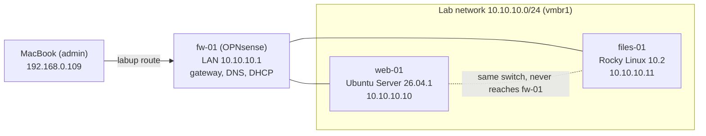
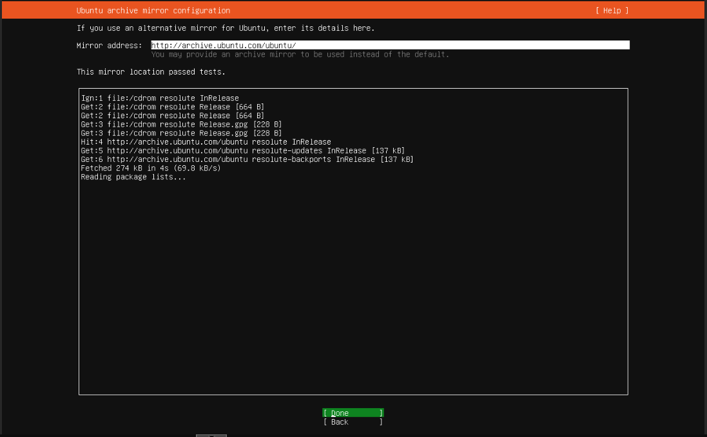

# Two Linux servers, one baseline: Ubuntu Server and Rocky Linux

**Date:** 2026-10-09 · **Phase:** 3 · **Time spent:** ~5 h for the whole phase (writeups 03 to 05)

## TL;DR

- I built two servers on the isolated lab network: `web-01` with Ubuntu Server 26.04.1 LTS and `files-01` with Rocky Linux 10.2. Both got the same baseline: a static IP, a named admin account, SSH with keys only, automatic security updates and their own firewall.
- The same goal took different tools on each one: netplan and NetworkManager, `ufw` (installed but off) and `firewalld` (on, with services open), `unattended-upgrades` (already on) and `dnf-automatic` (installed by hand). The [comparison table](#same-goal-two-families) sums it up.
- To turn off password logins I used a drop-in file named `00-hardening.conf`. `sshd` keeps the first value it reads, and Ubuntu's installer had left `50-cloud-init.conf` with `PasswordAuthentication yes`, so a change in `sshd_config` itself would have lost.
- The Proxmox browser console still dropped the Shift key, as in [writeup 02](02-opnsense-isolated-lab.md#problem-2-the-root-password-worked-on-the-console-but-not-in-the-browser). I added a serial console that passes text instead of keystrokes, and used it to check each server's SSH host key through a path that doesn't touch the network.
- DNSSEC validation is now on in the lab's resolver: a signed domain comes back with the `ad` flag, and a domain with a broken signature gets `SERVFAIL`.

## Goal

Two servers, one from each big Linux family, with the baseline any server should have before it runs anything: reachable only with my key, patched without me, and filtered by its own firewall. [Writeup 04](04-samba-vs-selinux.md) and [writeup 05](05-vm-backup-and-restore.md) build a file share, a web server and backups on top of them.

## Environment

| Component | Detail |
| --- | --- |
| Host | Proxmox VE 9.2 (`pve.home.arpa`), from [writeup 01](01-proxmox-dual-boot.md) |
| Network | The lab network `10.10.10.0/24` behind `fw-01`, from [writeup 02](02-opnsense-isolated-lab.md). Gateway, DNS and DHCP on `10.10.10.1` |
| `web-01` | VM 110, Ubuntu Server 26.04.1 LTS (kernel `7.0.0-38-generic` at install), `10.10.10.10` |
| `files-01` | VM 111, Rocky Linux 10.2 (kernel `6.12.0-211.16.1.el10_2` at install), `10.10.10.11` |
| Resources, each | 2 vCPUs (CPU type `host`), 2 GB RAM, 32 GB disk on `local-lvm` |
| Admin machine | MacBook, through the `labup` route, with the SSH key `~/.ssh/id_ed25519` (protected by a passphrase) |

## Background

**Two families.** Most Linux servers run a distribution from one of two families. Debian's (Debian, Ubuntu) uses `apt` and `.deb` packages; Red Hat's (RHEL, Rocky Linux, AlmaLinux) uses `dnf` and `.rpm` packages. The concepts carry over, but the tools, the defaults and where files live don't, and a job can put you in front of either. Rocky Linux is rebuilt from RHEL's sources, so what works on Rocky works on RHEL.

**Why each server needs its own firewall when the lab already has `fw-01`.** Both servers plug into `vmbr1`, the same virtual switch. Traffic between them never reaches `fw-01`, so `fw-01`'s rules can't see it. Between the two servers, the only filter is each server's own firewall.



## Same goal, two families

| Task | Ubuntu Server 26.04.1 (`web-01`) | Rocky Linux 10.2 (`files-01`) |
| --- | --- | --- |
| Installer | Subiquity, in text mode | Anaconda, graphical even from the Minimal ISO |
| Disk layout | LVM; `/` got 14.66 GB of the 32 GB disk, and the rest stays unallocated | Automatic partitioning |
| Admin group | `sudo` | `wheel` |
| Network configuration | netplan, set in the installer | NetworkManager, keyfile in `/etc/NetworkManager/system-connections/` |
| DNS on the server | `systemd-resolved`, with `/etc/resolv.conf` pointing at its local stub | `/etc/resolv.conf` written by NetworkManager |
| Updates right after install | `apt full-upgrade`: 21 packages | `dnf upgrade`: 98 upgraded, 6 new |
| Kernel command line | A file in `/etc/default/grub.d/`, then `update-grub` | `grubby --update-kernel=ALL` |
| SSH service name | `ssh` | `sshd` |
| `/etc/ssh/sshd_config.d/` after install | `50-cloud-init.conf`, readable by anyone | `40-redhat-crypto-policies.conf` and `50-redhat.conf`, readable only by root |
| Automatic updates | `unattended-upgrades`, already on | `dnf-automatic`, installed and enabled by hand |
| Host firewall | `ufw`, installed but off | `firewalld`, on, with `cockpit`, `dhcpv6-client` and `ssh` open |
| Mandatory access control | AppArmor | SELinux, enforcing ([writeup 04](04-samba-vs-selinux.md)) |

## What I did

### 1. DNSSEC on the lab's resolver

In phase 2, Unbound on `fw-01` resolved names without validating them. After a snapshot of `fw-01` (`pre-phase-3`), I turned it on in Services → Unbound DNS → General → **Enable DNSSEC Support**.

Once `web-01` existed, I tested it with one signed domain and one that is broken on purpose:

```text
nico@web-01:~$ dig @10.10.10.1 +dnssec debian.org | grep flags
;; flags: qr rd ra ad; QUERY: 1, ANSWER: 6, AUTHORITY: 0, ADDITIONAL: 1
; EDNS: version: 0, flags: do; udp: 1232
nico@web-01:~$ dig @10.10.10.1 dnssec-failed.org | grep status
;; ->>HEADER<<- opcode: QUERY, status: SERVFAIL, id: 13100
```

- `ad` (authenticated data) means Unbound checked the signatures on `debian.org` and they were valid.
- `dnssec-failed.org` is published with a broken signature to test exactly this. Unbound refuses to answer instead of passing on data it can't verify.

The query goes straight to `10.10.10.1` on purpose. On `web-01`, `systemd-resolved` only forwards queries (`resolvectl` shows `DNSSEC=no/unsupported`): the validation happens in Unbound, for every machine in the lab.

### 2. ISOs, names and the Mac's SSH config

**ISOs.** `ubuntu-26.04.1-live-server-amd64.iso` and `Rocky-10.2-x86_64-minimal.iso`, both in Proxmox's `local` storage and checked against the SHA-256 checksums each project publishes.

**Names.** `fw-01`'s DHCP server, Dnsmasq, registers the names of the machines it gives an address to. These two have static IPs and never ask, so I added them by hand in Services → Dnsmasq DNS & DHCP → Hosts:

| Host | Domain | IP address |
| --- | --- | --- |
| `web-01` | `lab.home.arpa` | `10.10.10.10` |
| `files-01` | `lab.home.arpa` | `10.10.10.11` |

Unbound already sends every query for `lab.home.arpa` to Dnsmasq, so that was all it took. From `web-01`, before `files-01` existed:

```text
nico@web-01:~$ getent hosts files-01.lab.home.arpa
10.10.10.11     files-01.lab.home.arpa
```

**The Mac's SSH config.** I added both servers to `~/.ssh/config`:

```text
Host web-01
    HostName 10.10.10.10
Host files-01
    HostName 10.10.10.11
Host web-01 files-01
    User nico
    IdentityFile ~/.ssh/id_ed25519
    IdentitiesOnly yes
    AddKeysToAgent yes
    UseKeychain yes
```

- **The IP, not the name:** the Mac asks my ISP's DNS servers for names, and they don't know `lab.home.arpa`.
- **`IdentitiesOnly`:** I have two keys, and the other one has no passphrase. This makes SSH offer only `id_ed25519`.
- **`UseKeychain`:** macOS keeps the passphrase in the Keychain, so I type it once.

### 3. The VMs

Both VMs have the same settings except for the ID, the name and the ISO:

| Setting | Value | Why |
| --- | --- | --- |
| VM ID / name | `110` / `web-01` and `111` / `files-01` | The ID ends like the IP, so there's nothing to look up |
| Guest OS | Linux, 7.x - 2.6 Kernel | Proxmox picks Linux-friendly defaults |
| CPU type | `host` | Rocky Linux 10 is built for x86-64-v3, and Proxmox's default type (x86-64-v2-AES) doesn't meet it. The i7-7700K does. Both VMs use the same type so they differ only in the distribution |
| Disk | 32 GB on `local-lvm`, **Discard** on | When the guest deletes files, it tells the disk (TRIM) and the space goes back to the thin pool. Without it, the pool only grows |
| RAM | 2 GB | Plenty for a server with no desktop, and both fit next to `fw-01` in the host's 16 GB |
| QEMU Guest Agent | On | Clean shutdowns from Proxmox, the IP in the Summary, and a consistent file system during backups ([writeup 05](05-vm-backup-and-restore.md)) |
| Network | `vmbr1`, VirtIO, Proxmox firewall off | The lab network, like `fw-01`'s LAN |
| Start at boot | Yes, order `2` | After `fw-01` (order 1), which gives them their gateway and DNS. Neither server needs the other to start |

The trade-off of CPU type `host`: a VM can't be live-migrated to a host with a different CPU. With one Proxmox node, that doesn't matter.

### 4. Installing Ubuntu Server on `web-01`

| Screen | Choice | Why |
| --- | --- | --- |
| Type of install | Ubuntu Server, not the minimized version | The minimized version removes tools meant for people who log in, like the `man` pages |
| Network | `ens18`, IPv4 manual: `10.10.10.10/24`, gateway and DNS `10.10.10.1`, search domain `lab.home.arpa` | A static IP outside the lab's DHCP range (`.100` to `.199`). Setting it here avoids typing YAML in a console that drops Shift: IP addresses only need digits, dots and slashes |
| Mirror | The default | Its test downloads package lists through `fw-01`'s NAT and resolves names through Unbound, so it also proved the lab network and DNSSEC worked |
| Storage | Whole disk, LVM, no encryption | LVM lets me grow the disk later without reinstalling. Encryption would ask for a passphrase at every boot, through that same console |
| Profile | User `nico`, a long password of lowercase letters and digits | A personal account leaves my name in the logs, unlike a shared `admin`. The password has to work in the browser console, which can't type Shift |
| SSH | OpenSSH server installed, password login allowed for now | Password logins were turned off once my real key was on the server (step 9) |



### 5. Installing Rocky Linux on `files-01`

Rocky's installer, Anaconda, is graphical even from the Minimal ISO. The system it installs isn't: with **Minimal Install**, `files-01` boots to a text console like `web-01`.

| Item | Choice | Why |
| --- | --- | --- |
| Network & Host Name | Host name `files-01`; `ens18` manual: `10.10.10.11/24`, gateway and DNS `10.10.10.1`, search domain `lab.home.arpa`; IPv6 disabled | The same values as Ubuntu, in a different screen. The lab is IPv4 only |
| Software Selection | Minimal Install | Only what a server needs; anything else gets installed when it's needed |
| Installation Destination | The 32 GB disk, automatic partitioning | |
| Root Account | Disabled, which is the default in Rocky 10 | I administer with `sudo` from my own account |
| User Creation | `nico`, administrator | Administrator means member of `wheel`, the group that can use `sudo` on Red Hat systems. On Ubuntu it's `sudo` |

### 6. First login and checks

From the Mac, with `labup` on. On `web-01` (trimmed):

```text
nico@web-01:~$ ip -br a
lo               UNKNOWN        127.0.0.1/8 ::1/128
ens18            UP             10.10.10.10/24 fe80::<redacted>/64
nico@web-01:~$ ip route
default via 10.10.10.1 dev ens18 proto static
10.10.10.0/24 dev ens18 proto kernel scope link src 10.10.10.10
nico@web-01:~$ resolvectl status
...
Link 2 (ens18)
Current DNS Server: 10.10.10.1
       DNS Servers: 10.10.10.1
        DNS Domain: lab.home.arpa
```

(I hid the IPv6 link-local address: it's built from the network card's MAC address.)

On `files-01`, the same network, set up by a different tool:

```text
[nico@files-01 ~]$ ip -br a
lo               UNKNOWN        127.0.0.1/8 ::1/128
ens18            UP             10.10.10.11/24
[nico@files-01 ~]$ cat /etc/resolv.conf
# Generated by NetworkManager
search lab.home.arpa
nameserver 10.10.10.1
[nico@files-01 ~]$ sudo grep -A6 '^\[ipv4\]' /etc/NetworkManager/system-connections/*.nmconnection
[ipv4]
address1=10.10.10.11/24
dns=10.10.10.1;
dns-search=lab.home.arpa;
gateway=10.10.10.1
method=manual
```

Then I updated both (`sudo apt full-upgrade` on Ubuntu, `sudo dnf upgrade` on Rocky), installed `qemu-guest-agent`, which neither had, and set the time zone on `web-01`: Ubuntu's server installer had left it on UTC.

### 7. Logging in with a key

```text
$ ssh-copy-id -i ~/.ssh/id_ed25519.pub web-01
/usr/bin/ssh-copy-id: INFO: Source of key(s) to be installed: "/Users/nico/.ssh/id_ed25519.pub"
...
Number of key(s) added:        1
```

`-i` picks the key. Without it, `ssh-copy-id` could have installed the other key too. The same command for `files-01`. From then on, `ssh web-01` stopped asking for the server's password.

### 8. A serial console, and checking the host keys

The Proxmox console runs in the browser (noVNC) and drops Shift from my Mac ([problem 1](#problem-1-the-proxmox-console-still-dropped-shift)). A serial console sends text instead of keystrokes, so I gave each server one.

On `web-01`, the kernel sends its messages and a login prompt to the serial port too:

```bash
echo 'GRUB_CMDLINE_LINUX_DEFAULT="$GRUB_CMDLINE_LINUX_DEFAULT console=tty0 console=ttyS0,115200"' | sudo tee /etc/default/grub.d/serial-console.cfg
sudo update-grub
sudo poweroff
```

On `files-01`, the same kernel options through `grubby`:

```bash
sudo grubby --update-kernel=ALL --args="console=tty0 console=ttyS0,115200"
sudo poweroff
```

Then, in Proxmox, with each VM off: Hardware → Add → Serial Port `0`, and Start. A power-off instead of a reboot because new hardware only shows up when Proxmox starts the VM again. In the VM's Console menu, **xterm.js** opens the serial console. Shift works there:

```text
nico@web-01:~$ echo ABC_def
ABC_def
```

The same console opens from the Mac's Terminal with `ssh pve` and `qm terminal 110` (Ctrl+O to leave).

**Checking the host keys.** The first time I connected to each server, SSH showed the fingerprint of its host key and asked whether to trust it. I accepted it blindly, as everyone does, so I checked afterwards through the serial console, which doesn't go through the network:

| Server | Fingerprint SSH showed on the Mac | Fingerprint on the serial console |
| --- | --- | --- |
| `web-01` | `SHA256:XXcdWTUXH5+7/hMppgQgvELFGqWTOD56Tj1B0WMzMDA` | `SHA256:XXcdWTUXH5+7/hMppgQgvELFGqWTOD56Tj1B0WMzMDA` |
| `files-01` | `SHA256:EkwwNf8++u1G2a+YBN5nAQfYQpOW6HpnxVAdvHN5ksI` | `SHA256:EkwwNf8++u1G2a+YBN5nAQfYQpOW6HpnxVAdvHN5ksI` |

The console side came from `ssh-keygen -lf /etc/ssh/ssh_host_ed25519_key.pub`. They match, so nobody was in the middle of those first connections.

### 9. SSH with keys only

The obvious place to turn off password logins is `/etc/ssh/sshd_config`. It would have failed on Ubuntu:

```text
nico@web-01:~$ ls /etc/ssh/sshd_config.d/
50-cloud-init.conf
```

`sshd_config` includes the files in `sshd_config.d/` at its top, in alphabetical order, and `sshd` keeps the **first** value it reads for each setting. The installer wrote `PasswordAuthentication yes` into `50-cloud-init.conf` when I allowed password logins, so that line would win over anything further down in `sshd_config`. A file whose name sorts first wins instead:

```bash
sudo tee /etc/ssh/sshd_config.d/00-hardening.conf >/dev/null <<'EOF'
PermitRootLogin no
PasswordAuthentication no
KbdInteractiveAuthentication no
EOF
sudo sshd -t && sudo systemctl reload ssh
```

`sshd -t` checks the syntax before the reload, and `sshd -T` prints the values `sshd` actually uses:

```text
nico@web-01:~$ sudo sshd -T | grep -E '^(permitrootlogin|passwordauthentication|kbdinteractiveauthentication) '
permitrootlogin no
passwordauthentication no
kbdinteractiveauthentication no
```

`KbdInteractiveAuthentication` is another way of asking for a password, so it goes off with the first one. On `files-01` the same file works, because Rocky also includes `sshd_config.d/` at the top. Only the service name changes: `systemctl reload sshd`. The output of `sshd -T` was the same.

Keeping the first session open, I tested from a second terminal: `ssh web-01` with the key worked, and forcing a password login (`ssh -o PubkeyAuthentication=no -o PreferredAuthentications=password web-01`) was refused with `Permission denied (publickey)`. Same result on `files-01`. The file is in [`configs/common/00-hardening.conf`](../configs/common/00-hardening.conf).

### 10. Automatic security updates

Both servers install security updates by themselves and never reboot by themselves. The lab only runs while I use it, and on real servers reboots go in a maintenance window. If an update needs a reboot, Ubuntu creates `/var/run/reboot-required`.

On Ubuntu it was already on. I checked instead of assuming:

```text
nico@web-01:~$ cat /etc/apt/apt.conf.d/20auto-upgrades
APT::Periodic::Update-Package-Lists "1";
APT::Periodic::Unattended-Upgrade "1";
nico@web-01:~$ sudo unattended-upgrade --dry-run --debug 2>&1 | tail -n 1
upgrade result: True No packages found that can be upgraded unattended and no pending auto-removals
```

On Rocky I installed it and set it to security updates only:

```bash
sudo dnf -y install dnf-automatic
sudo sed -i -e 's/^upgrade_type = .*/upgrade_type = security/' -e 's/^apply_updates = .*/apply_updates = yes/' /etc/dnf/automatic.conf
sudo systemctl enable --now dnf-automatic.timer
```

```text
[nico@files-01 ~]$ grep -E '^(upgrade_type|apply_updates|reboot)' /etc/dnf/automatic.conf
upgrade_type = security
apply_updates = yes
reboot = never
[nico@files-01 ~]$ systemctl list-timers dnf-automatic.timer
NEXT                        LEFT LAST PASSED UNIT                ACTIVATES
Sat 2026-10-10 06:44:15 -03  13h -         - dnf-automatic.timer dnf-automatic.service
```

The timer is what gets enabled, not the service: the timer decides when the service runs.

### 11. A firewall on each server

On Ubuntu, `ufw` was installed and off. The SSH rule goes in before `enable`, because `enable` blocks everything that comes in: the open session survives, but new ones don't.

```text
nico@web-01:~$ sudo ufw allow OpenSSH
nico@web-01:~$ sudo ufw enable
nico@web-01:~$ sudo ufw status verbose
Status: active
Logging: on (low)
Default: deny (incoming), allow (outgoing), disabled (routed)
New profiles: skip

To                         Action      From
--                         ------      ----
22/tcp (OpenSSH)           ALLOW IN    Anywhere
22/tcp (OpenSSH (v6))      ALLOW IN    Anywhere (v6)
```

On Rocky, `firewalld` was already on, with more open than the server needs:

```text
[nico@files-01 ~]$ sudo firewall-cmd --list-all
public (default, active)
  ...
  interfaces: ens18
  services: cockpit dhcpv6-client ssh
```

Cockpit, a web console, isn't installed, and the lab doesn't use IPv6, so I removed both:

```text
[nico@files-01 ~]$ sudo firewall-cmd --permanent --remove-service=cockpit --remove-service=dhcpv6-client
success
[nico@files-01 ~]$ sudo firewall-cmd --reload
success
[nico@files-01 ~]$ sudo firewall-cmd --list-all
public (default, active)
  ...
  services: ssh
```

`--permanent` writes the change to disk without applying it, and `--reload` applies it. A change made without `--permanent` works until the next reboot and then disappears.

Each server got a `baseline` snapshot at this point.

## What went wrong and how I fixed it

### Problem 1: the Proxmox console still dropped Shift

**Symptom.** In Ubuntu's installer, "Your name" came out as `nico` when I typed `Nico`. Later, in the Rocky console, I couldn't type the capital letters in a command (`grep -A6 ... /etc/NetworkManager/...`).

**Cause.** The same as in [writeup 02](02-opnsense-isolated-lab.md#problem-2-the-root-password-worked-on-the-console-but-not-in-the-browser): the Proxmox console runs in the browser (noVNC), and from my Mac, Shift doesn't reach the VM. It isn't specific to OPNsense.

**Fix.** Three parts:

- Everything typed on the servers goes over SSH from the Mac's Terminal, where Shift works and I can paste. The browser console is only for installers and emergencies.
- The passwords set during installation use only lowercase letters and digits, so they can be typed in that console too.
- Each server has a serial console ([step 8](#8-a-serial-console-and-checking-the-host-keys)), which sends text instead of keystrokes. `echo ABC_def` prints `ABC_def` there.

**Lesson.** When a tool keeps failing in the same way, build another way in instead of working around it every time.

### Smaller issues

| What happened | Cause | Fix |
| --- | --- | --- |
| Ubuntu's mirror screen looked stuck on `Reading package lists...` | The test had already finished. The result is the line at the top: `This mirror location passed tests.` | Done, and on to the next screen |
| `ls /etc/ssh/sshd_config.d/` on `files-01` said `Permission denied` | On Rocky that directory is readable only by root; on Ubuntu, by anyone | `sudo ls` |

## What I learned

- The same baseline takes different tools on each family, and the defaults differ too: `ufw` comes off and `firewalld` on, automatic updates come on in Ubuntu and off in Rocky. Check the defaults instead of assuming them.
- `sshd` keeps the first value it reads for each setting, and the files in `sshd_config.d/` are read before the rest of `sshd_config`. To know what `sshd` really uses, ask it with `sshd -T` rather than reading the file.
- The first SSH connection to a server trusts its host key blindly. Checking the fingerprint through another path, like a console, is what makes that trust justified.
- A firewall between networks doesn't see traffic between two machines on the same network. That's what host firewalls are for.
- DNSSEC validation happens in the resolver. A good test needs two names: one that should validate (`ad`) and one that should fail (`SERVFAIL`).
- A DHCP server only knows the names of the machines it gives addresses to. Machines with static IPs need DNS entries by hand.
- Rocky Linux 10 needs a CPU with x86-64-v3, so the VM's CPU type matters before the first boot.

## Troubleshooting

### `PasswordAuthentication no` doesn't take effect

```bash
sudo sshd -T | grep -E '^(passwordauthentication|kbdinteractiveauthentication|permitrootlogin) '
sudo ls /etc/ssh/sshd_config.d/
```

If another file in `sshd_config.d/` sets the same option, it wins if it sorts first. Put your settings in a file that sorts before it, like `00-hardening.conf`, run `sudo sshd -t`, reload, and test from a new terminal before closing the old one.

### The Proxmox console drops Shift or gets your keyboard layout wrong

For a Linux guest, add a serial console:

1. In the guest: on Ubuntu, add `console=tty0 console=ttyS0,115200` to `GRUB_CMDLINE_LINUX_DEFAULT` in a file under `/etc/default/grub.d/` and run `sudo update-grub`. On Rocky, `sudo grubby --update-kernel=ALL --args="console=tty0 console=ttyS0,115200"`.
2. Power the VM off. In Proxmox, Hardware → Add → Serial Port `0`, and start it.
3. Console → xterm.js, or `qm terminal <vmid>` from the Proxmox shell (Ctrl+O to leave).

### Rocky Linux 10 won't start in a new Proxmox VM

Rocky Linux 10 needs a CPU with x86-64-v3, and Proxmox's default CPU type (x86-64-v2-AES) doesn't provide it. With the VM off, set Hardware → Processors → Type to `host` (or `x86-64-v3`). I set it before installing, so I didn't run into this myself.

### A server with a static IP doesn't resolve by name in the lab

On OPNsense with Dnsmasq: Services → Dnsmasq DNS & DHCP → Hosts → add the host, domain and IP. Check from another lab machine with `getent hosts <name>.lab.home.arpa`.

## Next

- [Writeup 04](04-samba-vs-selinux.md): a Samba share on `files-01`, and SELinux blocking it.
- [Writeup 05](05-vm-backup-and-restore.md): nginx on `web-01`, backups of every VM, and a real restore.
- On `web-01`, `/` uses 14.66 GB of the 32 GB disk. When it needs more, it can grow without a reboot with `lvextend`.
