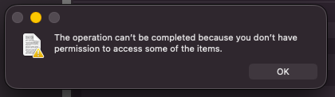

# A Samba share that SELinux blocked, and the right way to fix it

**Date:** 2026-10-09 · **Phase:** 3 · **Time spent:** ~5 h for the whole phase (writeups 03 to 05)

## TL;DR

- I shared `/srv/shared` from `files-01` (Rocky Linux 10.2) with Samba. My Mac connected and logged in, but Finder couldn't write anything: *"The operation can't be completed because you don't have permission to access some of the items."*
- The Unix permissions were fine. SELinux, which Rocky runs in enforcing mode, was blocking Samba: the folder was labeled `var_t`, and the Samba daemon may only serve files labeled `samba_share_t`. The audit log recorded every denied attempt, 43 of them.
- I fixed it with `semanage fcontext` and `restorecon`, which put the label in the SELinux policy, so it survives a relabel. Turning SELinux off (`setenforce 0`) or relabeling the folder with `chcon` would also have made Finder work, for the wrong reasons.
- I set this up knowing SELinux would object. The point was to practice reading the audit log instead of switching SELinux off.

## Goal

A shared folder on `files-01` that my Mac can read and write, with SELinux still enforcing.

## Environment

| Component | Detail |
| --- | --- |
| Server | `files-01`, VM 111, Rocky Linux 10.2, SELinux in enforcing mode ([writeup 03](03-linux-server-baseline.md)) |
| Samba | 4.23.5, from Rocky's BaseOS repository. Share `shared`, folder `/srv/shared` |
| Client | MacBook, Finder → Go → Connect to Server → `smb://10.10.10.11/shared` |
| Firewalls | `fw-01` lets the Mac into the lab ([writeup 02](02-opnsense-isolated-lab.md)); `firewalld` on `files-01` allows the `samba` service |

## Background: SELinux in two paragraphs

Unix permissions answer "may this **user** touch this file?". SELinux asks a second question: "may this **program** touch this kind of file?". Every process and every file carries a label, and the part of the label that matters here is the *type*. Samba's daemon runs as `smbd_t`. Files get types like `samba_share_t` for Samba shares, `httpd_sys_content_t` for web content or `var_t` for generic data. The policy lists which process types may do what to which file types; anything it doesn't list is denied and logged.

Both checks have to pass. That's what makes these failures confusing: `ls -l` says you own the folder and have full access, and the access is still denied. `ls -Z` shows the labels, and the audit log shows the denials.

## What I did

### 1. The share

```bash
sudo dnf -y install samba
sudo mkdir -p /srv/shared
sudo chown nico:nico /srv/shared
sudo tee -a /etc/samba/smb.conf >/dev/null <<'EOF'

[shared]
    path = /srv/shared
    read only = no
    valid users = nico
EOF
testparm -s
sudo smbpasswd -a nico
sudo systemctl enable --now smb
sudo firewall-cmd --permanent --add-service=samba
sudo firewall-cmd --reload
```

- **`/srv`** is the standard place for data a server offers to others.
- **`testparm`** checks `smb.conf` before the service starts. It printed the new share at the end, with no errors.
- **`smbpasswd -a`** gives `nico` a Samba password. Samba keeps its own password database, separate from the Linux one, because the SMB protocol needs passwords stored in a different form.
- **`firewall-cmd`** opens Samba's ports in `files-01`'s own firewall.

The share is in [`configs/files-01/smb-shared.conf`](../configs/files-01/smb-shared.conf).

## What went wrong and how I fixed it

### Problem 1: Finder could connect, but not write

**Symptom.** Finder connected to `smb://10.10.10.11/shared` and accepted the Samba password. Copying a file into the share failed:



**Evidence.** On `files-01`:

```text
[nico@files-01 ~]$ getenforce
Enforcing
[nico@files-01 ~]$ ls -ldZ /srv/shared
drwxr-xr-x. 2 nico nico unconfined_u:object_r:var_t:s0 6 Oct  9 17:09 /srv/shared
```

The Unix side was fine: `nico` owns the folder and can write to it, and Samba works as the user who logged in. The SELinux type, `var_t`, is not one Samba may serve. The audit log said so directly (trimmed to the three kinds of denial):

```text
[nico@files-01 ~]$ sudo ausearch -m AVC -ts recent
...
time->Fri Oct  9 17:11:47 2026
type=AVC msg=audit(1791576707.618:543): avc:  denied  { watch } for  pid=1495 comm="smbd-notifyd" path="/srv/shared" dev="dm-0" ino=17527397 scontext=system_u:system_r:smbd_t:s0 tcontext=unconfined_u:object_r:var_t:s0 tclass=dir permissive=0
----
time->Fri Oct  9 17:11:47 2026
type=AVC msg=audit(1791576707.629:544): avc:  denied  { create } for  pid=1514 comm="smbd[192.168.0." name=".DS_Store" scontext=system_u:system_r:smbd_t:s0 tcontext=system_u:object_r:var_t:s0 tclass=file permissive=0
----
time->Fri Oct  9 17:12:26 2026
type=AVC msg=audit(1791576746.158:550): avc:  denied  { create } for  pid=1514 comm="smbd[192.168.0." name="test.txt" scontext=system_u:system_r:smbd_t:s0 tcontext=system_u:object_r:var_t:s0 tclass=file permissive=0
```

How to read one of these lines:

| Field | Value | Meaning |
| --- | --- | --- |
| `denied { create }` | | What the process tried to do: create a file |
| `comm` | `smbd[192.168.0.` | The process: Samba names each connection's process after the client's address, cut to 15 characters |
| `name` | `test.txt` | The file it tried to create |
| `scontext` | `...:smbd_t:s0` | The process's type: Samba |
| `tcontext` | `...:var_t:s0` | The target's type: what the folder (and so the new file) was labeled |
| `tclass` | `file` | What kind of object the target is |
| `permissive=0` | | SELinux enforced the denial. With `1`, it would only have logged it |

The 43 Samba denials tell the story of the session:

- **One `watch` on the folder**, from `smbd-notifyd`, the part of Samba that tells clients when a folder changes.
- **Six `create` for `.DS_Store`**, as soon as Finder opened the share and before I had copied anything. Finder writes that file to keep its view settings for the folder.
- **Thirty-six `create` for `test.txt`**, the file I was copying, in four bursts between 17:12:26 and 17:12:59.

**Cause.** `mkdir` gave `/srv/shared` the type `var_t`, and the policy doesn't let `smbd_t` create or watch anything of that type.

**Fix.** Tell the policy that everything under `/srv/shared` is a Samba share, then apply it to what's already there:

```text
[nico@files-01 ~]$ sudo dnf -y install policycoreutils-python-utils
[nico@files-01 ~]$ sudo semanage fcontext -a -t samba_share_t '/srv/shared(/.*)?'
[nico@files-01 ~]$ sudo restorecon -Rv /srv/shared
Relabeled /srv/shared from unconfined_u:object_r:var_t:s0 to unconfined_u:object_r:samba_share_t:s0
```

`semanage` comes from `policycoreutils-python-utils`, which a Minimal install doesn't include. The `(/.*)?` makes the rule cover the folder and everything inside it, including files created later.

I disconnected in Finder, connected again and copied the file. This time it worked, and the folder changed:

```text
[nico@files-01 ~]$ ls -ldZ /srv/shared
drwxr-xr-x. 2 nico nico unconfined_u:object_r:samba_share_t:s0 6 Oct  9 17:09 /srv/shared
[nico@files-01 ~]$ ls -ldZ /srv/shared
drwxr-xr-x. 2 nico nico unconfined_u:object_r:samba_share_t:s0 76 Oct  9 17:17 /srv/shared
```

The first line is right after `restorecon`; the second, after copying from the Mac. The type is `samba_share_t`, and the folder's size and modification time changed because Finder could finally create files in it.

### Three ways to make the error go away

All three would have made Finder work. Only one keeps SELinux doing its job:

| Fix | What it does | After a reboot | After a relabel (`restorecon`, `fixfiles`) |
| --- | --- | --- | --- |
| `sudo setenforce 0` | Puts SELinux in permissive mode for the **whole server**: everything is allowed and only logged | Back to enforcing, from `/etc/selinux/config` | Not affected |
| `sudo chcon -R -t samba_share_t /srv/shared` | Changes the label on what exists now | Stays | **Reverted to `var_t`**: the policy still says `var_t` |
| `semanage fcontext` + `restorecon` | Adds a rule to the policy, then applies it | Stays | Stays |

There's also a switch (`setsebool -P samba_export_all_rw on`) that lets Samba read and write any file on the system. It works too, but it opens far more than one folder.

**Lessons.**

- When a permission error makes no sense from `ls -l`, check `getenforce`, `ls -Z` and the audit log before touching `chmod`.
- One AVC line holds the whole diagnosis: which process type, which action, which file type.
- Fix the label in the policy, not just on the files, and never by turning SELinux off.

### Smaller issues

| What happened | Cause | Fix |
| --- | --- | --- |
| The first two denials in `ausearch` had nothing to do with Samba | Two `dac_override` denials for `systemd-getty-generator`, the part of systemd that sets up login consoles at boot and on every `systemctl daemon-reload` | Ignored for this problem and noted for later. `ausearch -m AVC -ts recent \| grep smbd` shows only Samba's |

## What I learned

- SELinux is a second check on top of Unix permissions: a program can be refused something its user is allowed to do.
- `ls -Z` shows labels, and `ausearch -m AVC` shows denials. Together they explain an error that `ls -l` can't.
- `semanage fcontext` changes the policy, and `restorecon` applies it. `chcon` only changes the files, so the next relabel undoes it.
- A client does more than you ask it to. Finder's first write was `.DS_Store`, not my file.
- The audit log has more than the problem at hand. Filter it by the process you care about.

## Troubleshooting

```bash
getenforce                                   # Enforcing?
ls -ldZ /path/to/share                       # which type does the folder have?
sudo ausearch -m AVC -ts recent | grep smbd  # what was denied?
sudo dnf -y install policycoreutils-python-utils
sudo semanage fcontext -a -t samba_share_t '/path/to/share(/.*)?'
sudo restorecon -Rv /path/to/share
```

If the folder is already `samba_share_t` and access still fails, look elsewhere: the Unix permissions (`ls -ld`), `valid users` in `smb.conf`, whether the user has a Samba password (`sudo pdbedit -L`) and whether `sudo firewall-cmd --list-services` includes `samba`.

## Next

- Look into the `systemd-getty-generator` denials.
- [Writeup 05](05-vm-backup-and-restore.md): backups of every VM, and restoring one.
