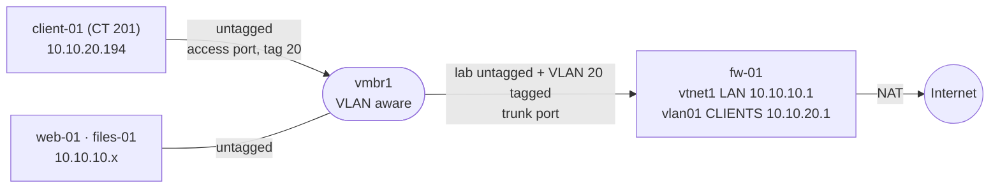
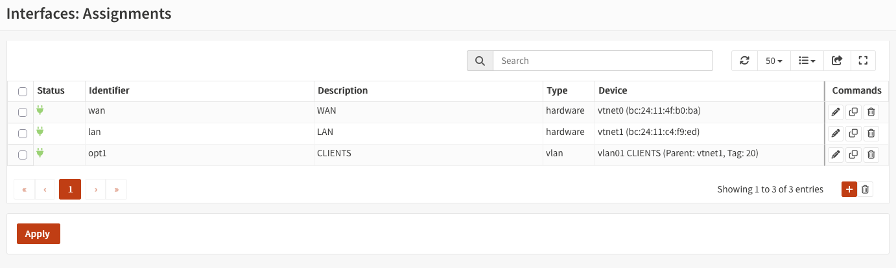
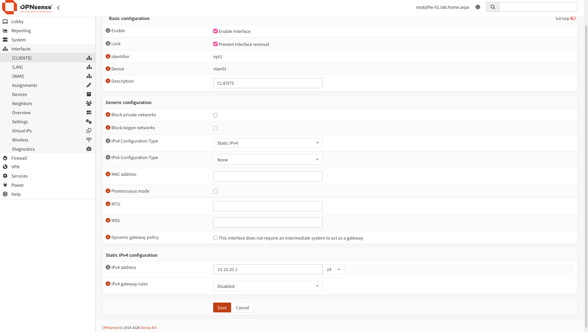
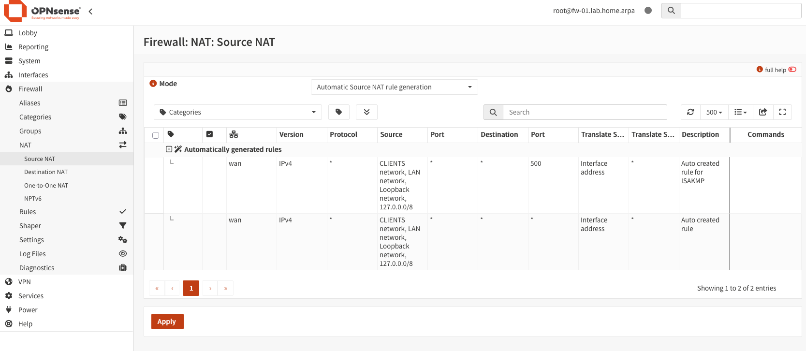
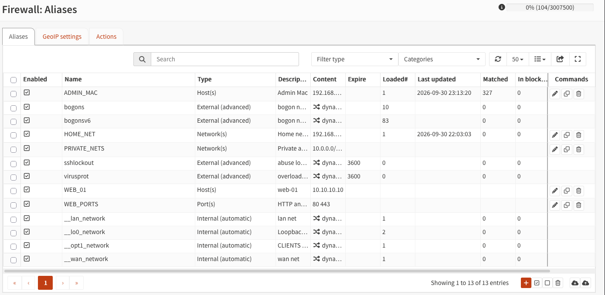
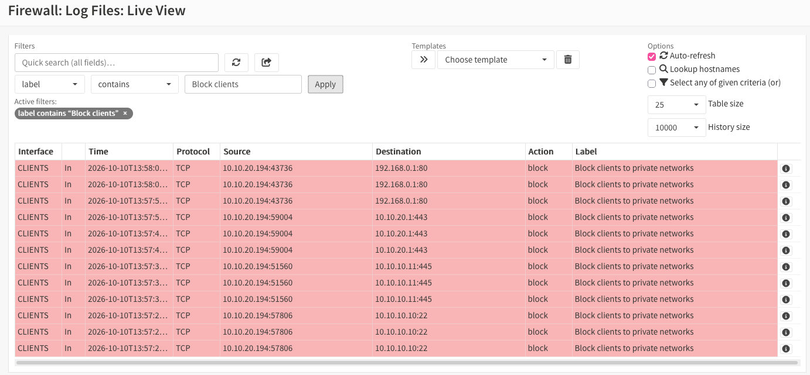

# A clients VLAN on the lab bridge, with rules that open one website and the internet

**Date:** 2026-10-10 · **Phase:** 4 · **Time spent:** ~5 h for the whole phase (writeups 06 and 07)

## TL;DR

- I added a second network to the lab, `CLIENTS` (`10.10.20.0/24`), as VLAN 20 on the same Proxmox bridge. No new network cards: `fw-01`'s lab card became a trunk that carries the lab network untagged and VLAN 20 tagged, and the test client, `client-01`, sits on an access port.
- Clients can use `web-01`'s website and the internet. Everything else that's private (the servers' SSH and Samba, `fw-01`'s web interface, my home network) is blocked and logged by one rule, which uses an alias with the three private address ranges.
- I tested every rule from `client-01` and matched each blocked test to its entry in the firewall log. With `tcpdump` on the Proxmox host, the same ping shows up with an 802.1Q tag on `fw-01`'s card (102 bytes) and without it on `client-01`'s (98 bytes).
- OPNsense 26.7 had renamed two settings my plan used: *IPv4 Upstream Gateway* is now *IPv4 gateway rules*, and *Outbound NAT* is now *Source NAT*.

## Goal

A network for user devices that can reach one internal website and the internet, and nothing else private. No new hardware, and no changes to anything that already works: the lab network, the rule that keeps the lab away from the house, and my access from the Mac stay as they were.

## Environment

| Component | Detail |
| --- | --- |
| Host | Proxmox VE 9.2. `vmbr1`, the lab bridge, has been VLAN aware since [writeup 02](02-opnsense-isolated-lab.md#1-a-bridge-for-the-lab) |
| Firewall | `fw-01`, OPNsense 26.7.5. Its lab card is `vtnet1` (Proxmox `net1`, no VLAN tag) |
| Servers | `web-01` (`10.10.10.10`, nginx) and `files-01` (`10.10.10.11`, Samba), from [writeups 03 to 05](03-linux-server-baseline.md) |
| Client | `client-01`, LXC container 201, Debian 13 (`debian-13-standard` template), 1 core, 512 MB RAM, 4 GB disk, on `vmbr1` with VLAN tag 20 |

## Background

**A VLAN splits one switch into several.** A frame that belongs to a VLAN carries a 4-byte 802.1Q tag between the source MAC address and the type field. Inside the tag is the VLAN ID, a number from 1 to 4094. A VLAN-aware switch only delivers a frame to ports that belong to its VLAN, so two VLANs on the same switch behave like two separate switches.

**Trunk and access ports.** A *trunk* port carries several VLANs, and its frames keep their tags so the device on the other end can tell them apart. An *access* port belongs to a single VLAN: the switch adds the tag when a frame comes in and removes it when a frame goes out, so the device never sees a tag and doesn't need to know VLANs exist. On a physical network, the port that goes to the router is usually a trunk, and the ports that go to PCs are access ports.

**The same thing in Proxmox.** On a VLAN-aware bridge, a virtual card with no tag gets the untagged frames plus every VLAN tagged: a trunk. A card with a tag gets only that VLAN, with the tag added and removed by Proxmox: an access port. So `fw-01`'s `net1` needed no change at all, and `client-01` only needed tag 20.

**Traffic between VLANs goes through the firewall.** In phase 3, two servers on the lab network talked directly through the bridge, and `fw-01` never saw it ([writeup 03](03-linux-server-baseline.md#background)). A machine on `CLIENTS` is on a different network: to reach `10.10.10.x`, it has to send the packet to its gateway, `10.10.20.1`, which is `fw-01`. That's why rules on `CLIENTS` can decide whether a client reaches a server's SSH, which the rules on the lab network never could.



## What I did

### 1. A snapshot first

A snapshot of `fw-01` called `pre-phase-4`, without RAM. A wrong interface assignment can lock me out of the web interface, and rolling back a snapshot takes a minute.

### 2. The VLAN in OPNsense

In Interfaces → Devices → VLAN → +:

| Field | Value | Why |
| --- | --- | --- |
| Device | Empty | OPNsense names it; it chose `vlan01` |
| Parent | `vtnet1` (LAN) | The card that's plugged into `vmbr1` |
| VLAN tag | `20` | The number that goes in each frame's tag |
| Description | `CLIENTS` | |

Then, in Interfaces → Assignments, I added `vlan01` as a new interface with the description `CLIENTS`. OPNsense gave it the identifier `opt1`:



The VLAN is a virtual card on top of `vtnet1`. Frames that arrive on `vtnet1` with tag 20 go to `vlan01`, and the ones without a tag stay on the LAN.

### 3. The `CLIENTS` interface

In Interfaces → [CLIENTS]:

| Field | Value | Why |
| --- | --- | --- |
| Enable | Checked | |
| IPv4 Configuration Type | Static IPv4 | `fw-01` is the gateway, so its address can't change |
| IPv6 Configuration Type | None | The lab is IPv4 only |
| IPv4 address | `10.10.20.1/24` | The same shape as the LAN, with 20 in the third part to match the VLAN |
| IPv4 gateway rules | Disabled | See below |
| Block private / bogon networks | Unchecked | Those filters are for interfaces that face the internet |



**IPv4 gateway rules** is the field my plan called *IPv4 Upstream Gateway* ([problem 1](#problem-1-two-settings-had-new-names-in-opnsense-267)). If a gateway is set there, OPNsense sends replies to anything that came in on this interface back through that gateway: the *reply-to* behavior I turned off in [writeup 02](02-opnsense-isolated-lab.md#4-reaching-the-web-interface-from-the-mac). The only gateway `fw-01` has is the home router, which isn't on this network at all. A gateway belongs on the WAN only, as with the LAN.

### 4. DHCP and DNS for the VLAN

In Services → Dnsmasq DNS & DHCP:

1. **General:** added `CLIENTS` to the interfaces Dnsmasq serves, next to `LAN`.
2. **DHCP ranges** → +: interface `CLIENTS`, from `10.10.20.100` to `10.10.20.199`, domain `lab.home.arpa`.

The range leaves `.2` to `.99` for static addresses, as on the LAN. DNS needed nothing new: Unbound already listens on every interface.

A DHCP request comes from `0.0.0.0` and goes to the broadcast address, so it can't match a rule whose source is `CLIENTS net`. I didn't need a rule for it: OPNsense lets DHCP through to its own DHCP server on the interfaces where that service runs. `client-01` got its address with only the four rules from [step 7](#7-the-rules-on-clients).

### 5. NAT for the new network

In automatic mode, OPNsense writes a NAT rule for each of its internal networks. The page is now Firewall → NAT → **Source NAT** (*Outbound* in my plan), and after the new interface, the automatic rules list `CLIENTS network` next to `LAN network`, translated to the WAN's address:



The rule for port 500 (*ISAKMP*) is a special case for IPsec VPNs, which the lab doesn't use. `Loopback network` and `127.0.0.0/8` are the firewall's own traffic.

### 6. Aliases

In Firewall → Aliases, three new ones, applied at the end:

| Name | Type | Content | Description |
| --- | --- | --- | --- |
| `PRIVATE_NETS` | Network(s) | `10.0.0.0/8`, `172.16.0.0/12`, `192.168.0.0/16` | Private addresses (RFC 1918) |
| `WEB_01` | Host(s) | `10.10.10.10` | web-01 |
| `WEB_PORTS` | Port(s) | `80`, `443` | HTTP and HTTPS |



`PRIVATE_NETS` holds the three ranges RFC 1918 sets aside for private networks. My plan had separate blocks for the servers and for `HOME_NET`; one alias covers both, plus `fw-01` itself, the branch networks from [writeup 07](07-site-to-site-wireguard-mikrotik.md) and any network I add later. I kept away from the trash icon in Firewall → Diagnostics → Aliases, which in [writeup 02](02-opnsense-isolated-lab.md#3c-the-rule-was-right-but-the-alias-was-empty) also deleted addresses from the saved alias.

### 7. The rules on `CLIENTS`

In Firewall → Rules → CLIENTS, all IPv4, in this order:

| Sequence | Action | Protocol | Source | Destination | Destination port | Log | Description |
| --- | --- | --- | --- | --- | --- | --- | --- |
| 10 | Pass | TCP/UDP | CLIENTS net | CLIENTS address | DNS (53) | No | `Allow clients DNS to firewall` |
| 20 | Pass | TCP | CLIENTS net | `WEB_01` | `WEB_PORTS` | No | `Allow clients to web-01 HTTP` |
| 30 | Block | any | CLIENTS net | `PRIVATE_NETS` | any | Yes | `Block clients to private networks` |
| 40 | Pass | any | CLIENTS net | any | any | No | `Allow clients to internet` |

- **The first match wins.** Rules 10 and 20 open the only private things a client needs. Rule 30 closes the rest, including `fw-01`'s web interface: `CLIENTS address` is `10.10.20.1`, which is inside `PRIVATE_NETS`. Whatever reaches rule 40 is, by elimination, the internet.
- **Only the destination port is set.** The source port stays *any* in every rule: a client picks a random source port for each connection, and the fixed number is the server's port (53, 80, 443).
- **A new interface blocks everything.** Before these rules, `CLIENTS` had none, and OPNsense blocks whatever no rule allows. That's why step 4 could finish with the VLAN still closed.

### 8. `client-01`

Create CT in Proxmox:

| Tab | Field | Value | Why |
| --- | --- | --- | --- |
| General | CT ID / Hostname | `201` / `client-01` | Servers use IDs that match their IP ([decisions](../docs/decisions.md#vm-ids-that-match-the-ip)); clients go in the 200s |
| General | Unprivileged | Checked | Root in the container isn't root on the host |
| General | Password | Random words, all lowercase | Strong because of its length, and typeable in any console. Rarely used: `pct enter 201` doesn't ask for it |
| Template | Template | `debian-13-standard` | The same one as in phase 2 |
| Disks | Disk size | `4` GB on `local-lvm` | |
| CPU / Memory | Cores / Memory | `1` / `512` MB | |
| Network | Bridge / VLAN Tag | `vmbr1` / `20` | The tag makes it an access port in VLAN 20 |
| Network | IPv4 / IPv6 | DHCP / Static, empty | `fw-01` gives it an address |
| Network | Firewall | Unchecked | One firewall, so every blocked test has one explanation |
| DNS | DNS domain / DNS servers | `lab.home.arpa` / `10.10.20.1` | Without this it copies the host's DNS (`1.1.1.1`) and skips the lab's |

A container is enough to test firewall rules: it starts in seconds, and its console (`pct enter` or xterm.js) passes Shift, unlike the browser console of a VM.

### 9. Testing each rule

From the Mac, `ssh pve` and `pct enter 201`:

```text
root@client-01:~# ip -br a
lo               UNKNOWN        127.0.0.1/8 ::1/128
eth0@if9         UP             10.10.20.194/24 fe80::be24:11ff:fe06:6c91/64
root@client-01:~# ip route
default via 10.10.20.1 dev eth0
10.10.20.0/24 dev eth0 proto kernel scope link src 10.10.20.194
root@client-01:~# apt update && apt install -y curl netcat-openbsd dnsutils
```

The address is inside the DHCP range and the gateway is `fw-01`. `apt` working already proves two rules: names resolve (rule 10) and the internet is reachable (rule 40). Then one test per rule:

```text
root@client-01:~# dig +short web-01.lab.home.arpa
10.10.10.10
root@client-01:~# curl -sI http://web-01.lab.home.arpa | head -n 1
HTTP/1.1 200 OK
root@client-01:~# nc -zv -w 3 10.10.10.10 22
nc: connect to 10.10.10.10 port 22 (tcp) timed out: Operation now in progress
root@client-01:~# nc -zv -w 3 10.10.10.11 445
nc: connect to 10.10.10.11 port 445 (tcp) timed out: Operation now in progress
root@client-01:~# nc -zv -w 3 10.10.20.1 443
nc: connect to 10.10.20.1 port 443 (tcp) timed out: Operation now in progress
root@client-01:~# nc -zv -w 3 192.168.0.1 80
nc: connect to 192.168.0.1 port 80 (tcp) timed out: Operation now in progress
root@client-01:~# curl -sI https://deb.debian.org | head -n 1
HTTP/2 200
```

| Test | Result | Rule |
| --- | --- | --- |
| The lab's DNS | `10.10.10.10` | 10 |
| `web-01`'s website | `HTTP/1.1 200 OK` | 20 |
| SSH on `web-01` | Timeout | 30 |
| Samba on `files-01` | Timeout | 30 |
| `fw-01`'s web interface | Timeout | 30 |
| The home router | Timeout | 30 |
| The internet | `HTTP/2 200` | 40 |

A timeout doesn't say why a connection failed, but the log does. In Firewall → Log Files → Live View, filtered by `label contains Block clients`, every timeout appears as a block by rule 30:



Each test shows up three times, with the same source port. That's TCP retrying: when a connection attempt gets no answer, the client sends its first packet (the `SYN`) again, and `nc` had three seconds to wait.

### 10. The tag on the wire

On `pve`, while `client-01` pinged `1.1.1.1`, I listened first on `fw-01`'s card (`tap100i1`: VM 100, `net1`) and then on `client-01`'s (`veth201i0`: CT 201, `net0`). `-e` prints the Ethernet header, which is where the tag goes:

```text
root@pve:~# tcpdump -eni tap100i1 -c 4 vlan 20 and icmp
14:15:56.274426 bc:24:11:06:6c:91 > bc:24:11:c4:f9:ed, ethertype 802.1Q (0x8100), length 102: vlan 20, p 0, ethertype IPv4 (0x0800), 10.10.20.194 > 1.1.1.1: ICMP echo request, id 955, seq 13, length 64
14:15:56.292030 bc:24:11:c4:f9:ed > bc:24:11:06:6c:91, ethertype 802.1Q (0x8100), length 102: vlan 20, p 0, ethertype IPv4 (0x0800), 1.1.1.1 > 10.10.20.194: ICMP echo reply, id 955, seq 13, length 64
...
root@pve:~# tcpdump -eni veth201i0 -c 4 icmp
14:16:12.298837 bc:24:11:06:6c:91 > bc:24:11:c4:f9:ed, ethertype IPv4 (0x0800), length 98: 10.10.20.194 > 1.1.1.1: ICMP echo request, id 955, seq 29, length 64
14:16:12.315601 bc:24:11:c4:f9:ed > bc:24:11:06:6c:91, ethertype IPv4 (0x0800), length 98: 1.1.1.1 > 10.10.20.194: ICMP echo reply, id 955, seq 29, length 64
...
```

(Trimmed to the first request and reply of each capture.)

The same ping, between the same two MAC addresses. On `fw-01`'s card each frame says `802.1Q`, carries `vlan 20` and is 102 bytes long; on `client-01`'s card it's a plain IPv4 frame of 98 bytes. The 4 bytes of difference are the tag: the trunk needs it to keep the VLANs apart, and on the access port Proxmox has already removed it.

Last, a snapshot of `fw-01` called `vlan-clients`, without RAM.

## What went wrong and how I fixed it

### Problem 1: two settings had new names in OPNsense 26.7

**Symptom.** Two steps of my plan pointed at things that weren't on the screen: an *IPv4 Upstream Gateway* field in the interface settings, and a Firewall → NAT → *Outbound* page.

**Cause.** The plan was written from documentation for older versions. In 26.7, the interface field is called *IPv4 gateway rules*, and the NAT page is *Source NAT*, with the mode *Automatic Source NAT rule generation*.

**Fix.** I matched each one by what it does, not by its name. OPNsense's interface documentation describes *gateway rules* as the setting that sends replies back through a gateway, which is the reply-to behavior the old field controlled, so it stays *Disabled*. *Source NAT* rewrites the source address of traffic leaving the WAN, which is what *Outbound NAT* did, and its automatic rules already included `CLIENTS` ([step 5](#5-nat-for-the-new-network)).

**Lesson.** When a guide and the product disagree, check what the setting does in the documentation for that version before choosing whatever looks closest.

### Smaller issues

| What happened | Cause | Fix |
| --- | --- | --- |
| `apt` in `client-01` printed `perl: warning: Setting locale failed` | The shell had `LANG=en_US.UTF-8`, apparently carried over from my Mac through SSH and `pct enter`, and the Debian template doesn't include that locale | Harmless; the packages installed. Left as is in a test container |
| `apt install dnsutils` said `selecting 'bind9-dnsutils' instead of 'dnsutils'` | On Debian 13, the `dig` tools come in the `bind9-dnsutils` package, and `apt` picked it for the old name | Nothing to fix: `dig` was installed |

## What I learned

- A VLAN is a 4-byte tag in the Ethernet frame. A trunk carries several VLANs and keeps the tags; an access port belongs to one VLAN, and the device on it never sees a tag. `tcpdump -e` shows the difference on the wire.
- On a VLAN-aware Proxmox bridge, the tag on a virtual card decides which kind of port it is. A new VLAN didn't need a new card on the firewall.
- Traffic between two VLANs has to go through their gateway, so the firewall can filter it. Traffic between two machines on the same network never reaches the firewall.
- One block rule with all the private ranges is easier to read than one rule per network, and it already covers networks that don't exist yet. The allow rules go above it.
- A new OPNsense interface blocks everything until it has rules, which makes it safe to build a network step by step.
- In the firewall log, one blocked TCP connection can appear several times: each retry of its first packet is checked and logged again.
- Version names drift. A setting is defined by what it does, and the documentation for the version in front of you is what settles it.

## Troubleshooting

### A client on a new VLAN doesn't get an IP address

In this order:

1. The client's card has the right VLAN tag, on a VLAN-aware bridge.
2. The firewall's card on that bridge has **no** tag, so it receives the VLAN tagged.
3. The DHCP server serves the new interface and has a range for it.
4. The requests reach the firewall. On the Proxmox host, with the firewall's card:

   ```bash
   tcpdump -eni tap<vmid>i<n> vlan <id> and port 67
   ```

   Nothing at all means the problem is in Proxmox (tags, bridge). Requests without replies means it's on the firewall.

### The client has an IP but doesn't resolve names

`cat /etc/resolv.conf` must point at the firewall's address on that VLAN. If it does, check the rule that allows DNS (TCP and UDP, destination port 53) and that it sits above any block.

### You can't find *IPv4 Upstream Gateway* or *Outbound NAT* in OPNsense 26.7

They're now *IPv4 gateway rules* (in the interface settings) and Firewall → NAT → *Source NAT*. For an internal interface, *IPv4 gateway rules* stays *Disabled*.

## Next

- [Writeup 07](07-site-to-site-wireguard-mikrotik.md): two MikroTik routers as branch offices, joined by a WireGuard tunnel.
- The lab network can still start connections to `CLIENTS`: OPNsense's default LAN rule allows the LAN to go anywhere. Nothing in the lab needs that, so it's a candidate for a block.
- If `CLIENTS` ever gets IPv6, these rules need IPv6 versions.
