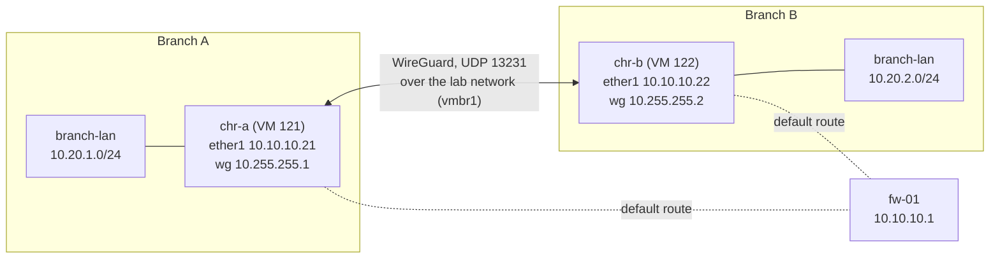
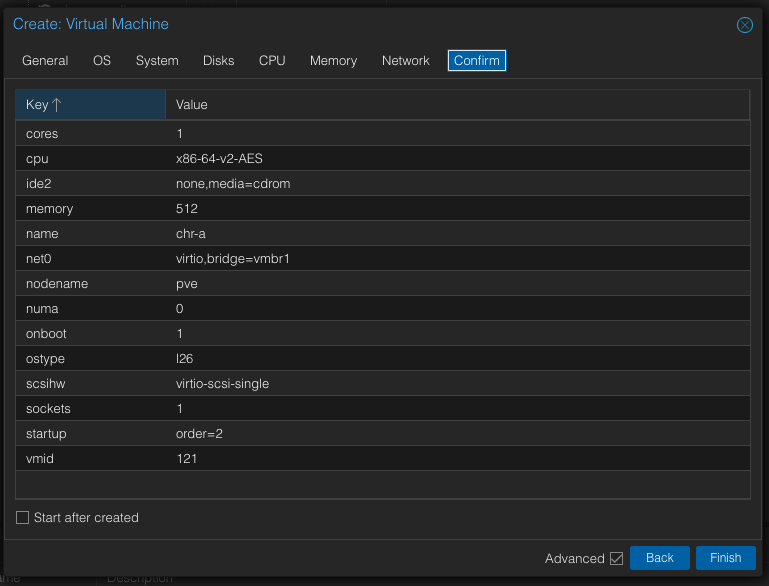
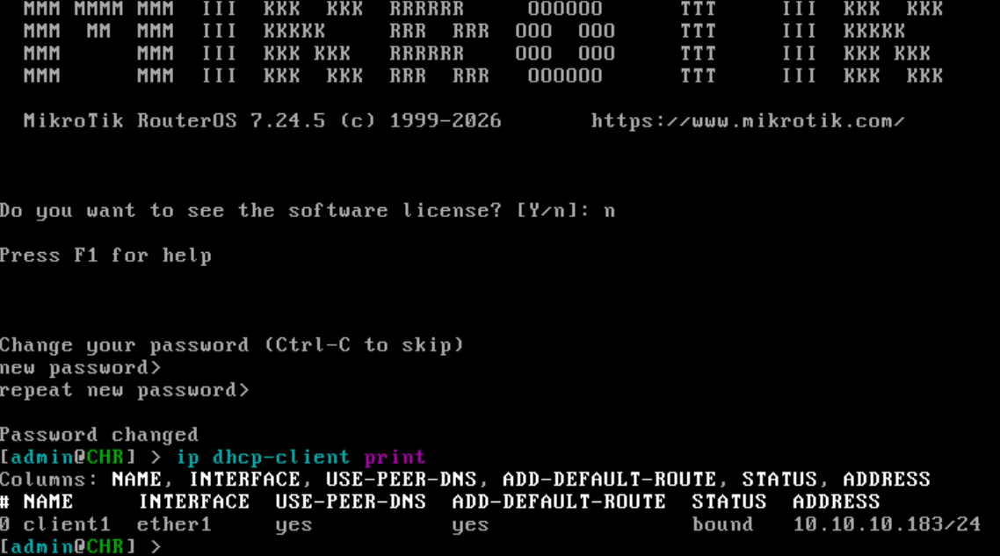

# Two branch routers and a WireGuard tunnel: MikroTik CHR on Proxmox

**Date:** 2026-10-10 · **Phase:** 4 · **Time spent:** ~5 h for the whole phase (writeups 06 and 07)

## TL;DR

- I ran two MikroTik Cloud Hosted Routers (RouterOS 7.24.5, free license) as VMs on the lab network, as the routers of two branch offices. Each one has its own branch LAN, and a WireGuard tunnel with static routes joins them.
- From branch A's LAN to branch B's: 0% packet loss and a single hop in `traceroute`. On the lab network between them, `tcpdump` sees only UDP on port 13231 between the two routers; in 10 seconds of pinging, not one ICMP packet and not one branch address.
- Both routers are reachable over SSH only with my key, as my own user. The default `admin` user is disabled and the services I don't use are off. I checked that a password login is refused.
- Their configurations are in the repository as RouterOS exports. RouterOS 7 leaves out the WireGuard private keys; I removed each router's `system id` line and the Windows line endings.
- Two things to learn from: removing the DHCP client cut the SSH session that was using the DHCP address, and the passwords I typed inside `/user add` commands ended up in my terminal log.

## Goal

Two branch offices that reach each other through an encrypted tunnel over a network they don't trust, the way small companies and ISPs' customers connect their sites. Here, the lab network plays the internet between the branches.

## Environment

| Component | Detail |
| --- | --- |
| Routers | `chr-a` (VM 121) and `chr-b` (VM 122): MikroTik CHR, RouterOS 7.24.5 (stable), free license |
| Resources, each | 1 vCPU (Proxmox's default type, x86-64-v2-AES), 512 MB RAM, the 128 MB CHR disk image as VirtIO Block, one VirtIO card on `vmbr1` without a VLAN tag |
| "Internet" | The lab network `10.10.10.0/24`. Default gateway and DNS: `fw-01` (`10.10.10.1`), from [writeup 02](02-opnsense-isolated-lab.md) |
| Admin machine | MacBook, through the `labup` route, with the SSH key `~/.ssh/id_ed25519` |

| | `chr-a` | `chr-b` |
| --- | --- | --- |
| `ether1` (lab network) | `10.10.10.21/24` | `10.10.10.22/24` |
| `branch-lan` (branch LAN) | `10.20.1.1/24` | `10.20.2.1/24` |
| `wg-site-to-site` (tunnel) | `10.255.255.1/30` | `10.255.255.2/30` |

## Background

**A CHR is RouterOS for virtual machines.** MikroTik publishes it as a ready-made disk image instead of an installer: you attach the image to a VM and boot it. The free license doesn't expire and limits upload to 1 Mbps per interface, which is plenty for tests.

**WireGuard in four ideas.**

- Each end has a key pair. The private key never leaves the router; the two ends only exchange public keys, as with SSH.
- It runs over UDP, here on port 13231, RouterOS's default. Outside the tunnel, the traffic between two branches is only UDP between the two routers' addresses.
- Each router lists the other as a *peer*, and `allowed-address` does two jobs: it's the list of source addresses accepted from that peer, and the list of destinations sent to it. So it holds the other end of the tunnel and the LAN behind it.
- The routing table still decides which packets go into the tunnel interface at all. A route to the remote LAN and the peer's `allowed-address` are both needed.

**Why the tunnel never reaches `fw-01`.** Both routers are on the lab network, so the tunnel goes from one to the other directly through `vmbr1`, like the traffic between the servers in [writeup 03](03-linux-server-baseline.md#background). `fw-01` is only their way to the real internet.



## What I did

### 1. Two empty VMs

Create VM, with the same values for both routers apart from the ID and name:

| Tab | Setting | Value | Why |
| --- | --- | --- | --- |
| General | VM ID / Name | `121` / `chr-a` and `122` / `chr-b` | The ID ends like the IP, as with the servers |
| General | Start at boot / order | Yes / `2` | After `fw-01`, like the servers |
| OS | Media | Do not use any media | RouterOS isn't installed: the VM boots from MikroTik's image |
| OS | Guest OS | Linux, newest version | RouterOS runs on a Linux kernel |
| Disks | The proposed disk | Deleted | The disk will be MikroTik's image ([step 2](#2-the-disk-image)) |
| CPU | Cores / Type | `1` / default | Unlike Rocky Linux in phase 3, RouterOS runs on the default CPU type |
| Memory | Memory | `512` MiB | MikroTik's minimum for RouterOS 7 |
| Network | Bridge / VLAN tag / Model / Firewall | `vmbr1` / none / VirtIO / off | The lab network, untagged |
| Confirm | Start after created | Unchecked | There's no disk yet |



### 2. The disk image

On MikroTik's download page, the CHR images have their own **CHR** tab. The IMG and ISO on the RouterOS tab are for installing on physical x86 hardware. On the CHR tab, channel Stable, I copied the link of **RAW disk** (the x86 one, not arm64) and downloaded it on the Proxmox host:

```text
root@pve:~# cd /root
root@pve:~# ver=7.24.5
root@pve:~# wget https://download.mikrotik.com/routeros/$ver/chr-$ver.img.zip
...
2026-10-10 14:48:42 (302 KB/s) - 'chr-7.24.5.img.zip' saved [45293979/45293979]
root@pve:~# unzip -t chr-$ver.img.zip
Archive:  chr-7.24.5.img.zip
    testing: chr-7.24.5.img           OK
No errors detected in compressed data of chr-7.24.5.img.zip.
root@pve:~# sha256sum chr-$ver.img.zip
16f07222a3213352c9c4fbea4f4dec6a8ffb78fdc0fa5e398c23103ed357c6eb  chr-7.24.5.img.zip
root@pve:~# unzip chr-$ver.img.zip
root@pve:~# qm disk import 121 chr-$ver.img local-lvm
...
unused0: successfully imported disk 'local-lvm:vm-121-disk-0'
root@pve:~# qm disk import 122 chr-$ver.img local-lvm
...
unused0: successfully imported disk 'local-lvm:vm-122-disk-0'
```

- **No checksum to compare.** The download page doesn't publish one. `unzip -t` checks the CRCs inside the zip, which catches a truncated or damaged download, and HTTPS from `download.mikrotik.com` covers the way here. The `sha256sum` records exactly which file I used.
- **`qm disk import`** copies the image into the thin pool as a new disk of the VM. It shows up in Hardware as *Unused Disk 0*, not connected to anything yet.

Then, on each VM:

1. Hardware → Unused Disk 0 → Edit → Bus/Device **VirtIO Block** → Add. VirtIO is what MikroTik supports on Proxmox.
2. Options → Boot Order: only `virtio0` enabled, and first. `ide2` (the empty CD drive) and `net0` (booting from the network, not the network card itself) off: if the disk fails to boot, the VM stops at `No bootable device` right away instead of searching the network first.

### 3. First boot, from the Proxmox console

On each VM, Start and Console (noVNC, the browser console). Log in as `admin` with no password, `n` to the license, and RouterOS asks for a new password right away. I used only lowercase letters and digits, because this console drops Shift from my Mac ([writeup 03](03-linux-server-baseline.md#problem-1-the-proxmox-console-still-dropped-shift)). Then:

```text
[admin@CHR] > ip dhcp-client print
```



A new CHR comes with a DHCP client on `ether1`, and `fw-01` had given `chr-a` `10.10.10.183` and `chr-b` `10.10.10.130`. That address is the way in over SSH, so that everything after this goes through the Mac's Terminal, where Shift works and I can paste. I typed the command without the leading `/`: from the top menu it works the same, and on some keyboards `/` needs Shift.

### 4. A named user, a fixed address and fewer services

From the Mac, `ssh admin@10.10.10.183`, accepting the router's RSA host key, and on `chr-a`:

```text
/system identity set name=chr-a
/user add name=nico group=full password=<password>
/ip address add address=10.10.10.21/24 interface=ether1 comment="lab network"
/ip route add dst-address=0.0.0.0/0 gateway=10.10.10.1 comment="default via fw-01"
/ip dns set servers=10.10.10.1
/ip service disable telnet,ftp,www,api,api-ssl
```

- **`identity`** is the router's name, the one in the prompt.
- **`nico`** is a named account, as on the servers ([decisions](../docs/decisions.md#a-personal-admin-account-with-a-console-safe-password)). Typing its password inside the command was a mistake ([problem 2](#problem-2-two-passwords-ended-up-in-my-terminal-log)).
- **The address, route and DNS** replace what the DHCP client provides, before I remove it in the next step.
- **`/ip service disable`** turns off the ways in I don't use: telnet, FTP, the web interface and the API. SSH and WinBox stay.

Then I copied my public key to the router and assigned it to `nico`:

```bash
scp ~/.ssh/id_ed25519.pub admin@10.10.10.183:nico.pub
```

```text
/user ssh-keys import public-key-file=nico.pub user=nico
```

### 5. Moving to the fixed address and closing the door behind me

On the Mac, the routers in `~/.ssh/config`:

```text
Host chr-a
    HostName 10.10.10.21
Host chr-b
    HostName 10.10.10.22
Host chr-a chr-b
    User nico
    IdentityFile ~/.ssh/id_ed25519
    IdentitiesOnly yes
```

The first `ssh chr-a` already went to the fixed address, as `nico` and with the key:

```text
$ ssh chr-a
The authenticity of host '10.10.10.21 (10.10.10.21)' can't be established.
RSA key fingerprint is: SHA256:cjUNsEaB3QxLE2aC+3RB6Mf+KJUrVqnUohFBGo0Z4+Q
This host key is known by the following other names/addresses:
    ~/.ssh/known_hosts:25: 10.10.10.183
```

`ssh` recognized the host key from the DHCP address, so `10.10.10.21` is the same router I had just configured, not another device on that address. From this session:

```text
[nico@chr-a] > /ip dhcp-client remove [find interface=ether1]
[nico@chr-a] > /user disable admin
[nico@chr-a] > /ip address print
Columns: ADDRESS, NETWORK, INTERFACE, VRF
# ADDRESS         NETWORK     INTERFACE  VRF
;;; lab network
0 10.10.10.21/24  10.10.10.0  ether1     main
[nico@chr-a] > /ip route print
Flags: D - DYNAMIC; A - ACTIVE; c - CONNECT, s - STATIC
Columns: DST-ADDRESS, GATEWAY, ROUTING-TABLE, DISTANCE
#     DST-ADDRESS    GATEWAY     ROUTING-TABLE  DISTANCE
;;; default via fw-01
0  As 0.0.0.0/0      10.10.10.1  main                  1
  DAc 10.10.10.0/24  ether1      main                  0
[nico@chr-a] > /ip ssh print
                           ciphers: auto
                forwarding-enabled: no
           password-authentication: yes-if-no-key
  publickey-authentication-options: none
                     strong-crypto: no
                     host-key-size: 2048
                     host-key-type: rsa
```

- **Without the DHCP client**, the router's address no longer depends on `fw-01`. Removing it also cut my first session, the one on `.183` ([problem 1](#problem-1-removing-the-dhcp-client-cut-my-first-ssh-session)).
- **`admin`** is the first user name any attack tries.
- **`yes-if-no-key`** means RouterOS only accepts a password over SSH from users that have no key. `nico` has one, so for `nico` it's keys only: the RouterOS equivalent of `PasswordAuthentication no` on the servers.

To check that last part, a connection that refuses to use the key:

```text
$ ssh -o PubkeyAuthentication=no chr-a
nico@10.10.10.21: Permission denied (publickey).
```

The router doesn't even offer a password prompt.

### 6. `chr-b`

Steps 4 and 5 again from `10.10.10.130`, with `name=chr-b` and `10.10.10.22/24`. Its host key fingerprint is `SHA256:NGfW/k2hG+1Sb8YdtG3dtPzL4nG36uyfhlleXcXvpp0`, and `ssh` recognized it on `10.10.10.22` from the DHCP address, as with `chr-a`.

### 7. The branch LANs

On `chr-a`:

```text
/interface bridge add name=branch-lan comment="branch A LAN"
/ip address add address=10.20.1.1/24 interface=branch-lan
```

On `chr-b`, the same with `comment="branch B LAN"` and `10.20.2.1/24`.

A bridge with no ports is the usual way to get an interface in RouterOS that's always up, like a loopback. It stands for each branch's LAN without adding more VMs.

Then a snapshot of each router called `base-config`, without RAM. RouterOS writes every change to disk as soon as it's applied, with no separate "save the configuration" step, so the disk already holds everything.

### 8. The tunnel

**The interfaces.** On `chr-a`:

```text
[nico@chr-a] > /interface wireguard add name=wg-site-to-site listen-port=13231 comment="tunnel to chr-b"
[nico@chr-a] > /ip address add address=10.255.255.1/30 interface=wg-site-to-site
[nico@chr-a] > /interface wireguard print
Flags: R - RUNNING
0 R ;;; tunnel to chr-b
    name="wg-site-to-site" mtu=1420 listen-port=13231 public-key="hboNHJ8fTQ1t/IFM9OZu8dG2Cqy/u7iOhusmOYK+WQ4="
```

On `chr-b`, the same with `comment="tunnel to chr-a"` and `10.255.255.2/30`; its public key is `muOo7m1X4GP9i/S+mVK9A1F9tvxXukAEnOc7hvmPyUo=`. Creating the interface generates the key pair, and `print` shows only the public half. A `/30` has exactly two usable addresses, one for each end.

**The peers.** Each router gets the other's public key. On `chr-a`:

```text
/interface wireguard peers add interface=wg-site-to-site comment="chr-b" public-key="muOo7m1X4GP9i/S+mVK9A1F9tvxXukAEnOc7hvmPyUo=" endpoint-address=10.10.10.22 endpoint-port=13231 allowed-address=10.255.255.2/32,10.20.2.0/24 persistent-keepalive=25s
```

On `chr-b`:

```text
/interface wireguard peers add interface=wg-site-to-site comment="chr-a" public-key="hboNHJ8fTQ1t/IFM9OZu8dG2Cqy/u7iOhusmOYK+WQ4=" endpoint-address=10.10.10.21 endpoint-port=13231 allowed-address=10.255.255.1/32,10.20.1.0/24 persistent-keepalive=25s
```

- **`endpoint-address` and `endpoint-port`** are where to send the encrypted packets: the other router's address on the lab network.
- **`allowed-address`** holds the other end of the tunnel and the LAN behind it.
- **`persistent-keepalive=25s`** sends a packet every 25 seconds. WireGuard says nothing when there's no traffic, so without it nothing would show that the tunnel is up until someone used it.

**The routes.** On `chr-a`:

```text
/ip route add dst-address=10.20.2.0/24 gateway=wg-site-to-site comment="branch B via tunnel"
```

On `chr-b`:

```text
/ip route add dst-address=10.20.1.0/24 gateway=wg-site-to-site comment="branch A via tunnel"
```

The route sends the other branch's traffic into the tunnel interface, and `allowed-address` decides which peer inside the tunnel gets it. With only one peer per router that sounds redundant, but without the route the packets for `10.20.2.0/24` would follow the default route to `fw-01`.

### 9. Testing from `chr-a`

```text
[nico@chr-a] > /interface wireguard peers print detail
0  ;;; chr-b
   interface=wg-site-to-site name="peer1" public-key="muOo7m1X4GP9i/S+mVK9A1F9tvxXukAEnOc7hvmPyUo=" endpoint-address=10.10.10.22 endpoint-port=13231 current-endpoint-address=10.10.10.22
   current-endpoint-port=13231 allowed-address=10.255.255.2/32,10.20.2.0/24 persistent-keepalive=25s client-endpoint="" client-allowed-address="" rx=180 tx=928 last-handshake=1m15s
[nico@chr-a] > /ping 10.255.255.2 count=3
  SEQ HOST                                     SIZE TTL TIME       STATUS
    0 10.255.255.2                               56  64 343us
    1 10.255.255.2                               56  64 378us
    2 10.255.255.2                               56  64 267us
    sent=3 received=3 packet-loss=0% min-rtt=267us avg-rtt=329us max-rtt=378us
[nico@chr-a] > /ping 10.20.2.1 src-address=10.20.1.1 count=3
  SEQ HOST                                     SIZE TTL TIME       STATUS
    0 10.20.2.1                                  56  64 375us
    1 10.20.2.1                                  56  64 353us
    2 10.20.2.1                                  56  64 338us
    sent=3 received=3 packet-loss=0% min-rtt=338us avg-rtt=355us max-rtt=375us
[nico@chr-a] > /tool traceroute 10.20.2.1 src-address=10.20.1.1
Columns: ADDRESS, LOSS, SENT, LAST, AVG, BEST, WORST, STD-DEV
#  ADDRESS    LOSS  SENT  LAST   AVG  BEST  WORST  STD-DEV
0  10.20.2.1  0%     144  0.2ms  0.2  0.1   0.4    0.1
```

- **`last-handshake=1m15s`.** The two ends agreed on keys 75 seconds earlier. WireGuard renews them every two minutes while there's traffic, and the keepalive makes sure there is, so a value under about two minutes means the tunnel is alive.
- **The first ping** goes from one end of the tunnel to the other.
- **The second ping** is the one that matters. Without `src-address`, it would leave from `10.255.255.1` and wouldn't test the way back to `10.20.1.0/24`. From `10.20.1.1`, `chr-b` has to know how to reach branch A's LAN, which is what happens between two real branches.
- **`traceroute`** shows one row per hop, numbered from 0, and keeps updating until it's stopped. One row, `10.20.2.1`: inside the tunnel, `chr-b` is one hop away, whatever lies between the two routers.

Then a snapshot of each router called `wireguard-ok`, without RAM.

### 10. The tunnel from the outside

With a continuous `/ping 10.20.2.1 src-address=10.20.1.1` running on `chr-a`, I listened on its card from the Proxmox host. `tap121i0` is the host side of VM 121's `net0`, which is `chr-a`'s `ether1`:

```text
root@pve:~# tcpdump -ni tap121i0 -c 6 udp port 13231
listening on tap121i0, link-type EN10MB (Ethernet), snapshot length 262144 bytes
15:57:47.971071 IP 10.10.10.21.13231 > 10.10.10.22.13231: UDP, length 96
15:57:47.971249 IP 10.10.10.22.13231 > 10.10.10.21.13231: UDP, length 96
15:57:48.972704 IP 10.10.10.21.13231 > 10.10.10.22.13231: UDP, length 96
15:57:48.972809 IP 10.10.10.22.13231 > 10.10.10.21.13231: UDP, length 96
15:57:49.974277 IP 10.10.10.21.13231 > 10.10.10.22.13231: UDP, length 96
15:57:49.974438 IP 10.10.10.22.13231 > 10.10.10.21.13231: UDP, length 96
6 packets captured
root@pve:~# timeout 10 tcpdump -ni tap121i0 'icmp or net 10.20.0.0/16'
listening on tap121i0, link-type EN10MB (Ethernet), snapshot length 262144 bytes

0 packets captured
```

(Trimmed to the packets and the counts.)

The first capture shows each ping going out and coming back, one per second, always UDP 13231 between `.21` and `.22`. The second looked for what shouldn't be on the wire, a ping or any branch address, and found nothing in 10 seconds while the ping kept running.

The size adds up too. RouterOS's ping size (`SIZE 56`) is the whole IP packet. WireGuard pads it to a multiple of 16 bytes (64), puts a 16-byte header in front and a 16-byte authentication tag after it: 96 bytes of UDP payload.

That's what anyone watching the network in between would see, like an ISP between two real branches: two routers exchanging UDP, with no way to tell what they say or which networks are behind them.

### 11. The configurations in the repository

From the repository folder on the Mac:

```bash
ssh chr-a /export | tr -d '\r' > configs/chr-a/export.rsc
ssh chr-b /export | tr -d '\r' > configs/chr-b/export.rsc
grep -niE 'private-key|password|system id|software id' configs/chr-*/export.rsc
```

[`configs/chr-a/export.rsc`](../configs/chr-a/export.rsc) and [`configs/chr-b/export.rsc`](../configs/chr-b/export.rsc) are each router's configuration written as commands, so they can be read, compared with `git diff` and loaded again.

- **What `/export` leaves out.** In RouterOS 7, sensitive data stays out unless you ask for it with `show-sensitive`: the WireGuard interfaces appear without their private keys. Users and their SSH keys aren't exported at all, and neither is anything left at its default. So the hardening from steps 4 and 5 isn't in these files; it's in this writeup.
- **What I removed.** The `grep` found one line on each router, `# system id = ...` in the header, which identifies that installation for licensing. I deleted it by hand.
- **`tr -d '\r'`.** RouterOS sends text with Windows line endings, and `git` would show a `^M` at the end of every line.
- **The public keys stay.** A WireGuard public key is meant to be shared, like an SSH `.pub` file: nobody can impersonate a router or decrypt the tunnel with it.

## What went wrong and how I fixed it

### Problem 1: removing the DHCP client cut my first SSH session

**Symptom.** In one Terminal tab I still had the first session, the one opened as `admin` to the DHCP address. Right after I removed the DHCP client from a second tab, the first one died:

```text
Read from remote host 10.10.10.183: Operation timed out
Connection to 10.10.10.183 closed.
client_loop: send disconnect: Broken pipe
```

**Cause.** The address `10.10.10.183` belonged to the DHCP lease. Removing the DHCP client removed the address with it, and a session to an address that no longer exists has nowhere to go.

**Fix.** Nothing to fix: the second session was on the fixed address, `.21`, and kept working. That order mattered. Had I removed the DHCP client from the `.183` session, I would have cut the only session I had, and the way back would have been the browser console that drops Shift.

**Lesson.** When changing a device's address remotely, first open a session on the address that stays, and only then take away the old one.

### Problem 2: two passwords ended up in my terminal log

**Symptom.** Reading my terminal log back to write this, the `/user add` line on each router shows the `nico` password in plain text.

**Cause.** I record every session with `script`, and `script` keeps everything the terminal shows. RouterOS echoes a command as it's typed, so a password inside a command is recorded with it. The two passwords also followed one pattern, so knowing one gave away the other.

**Fix.** The log stays out of the repository, as all my terminal logs do, and both passwords get replaced by generated ones, set with the recording paused. With `yes-if-no-key`, SSH doesn't accept them anyway, but WinBox does.

**Lesson.** A terminal log is a secret-holding file. Anything typed inside a command, a password included, ends up in it.

### Smaller issues

| What happened | Cause | Fix |
| --- | --- | --- |
| The first `scp` and `ssh` as `admin` said `Permission denied` twice | I mistyped the temporary `admin` password. RouterOS showed both failures (`login failure for user admin from 192.168.0.109 via ssh`) at my next login, stamped 18:15 and 18:16, three hours ahead of my local time: the routers' clocks run on UTC | Typed it again. Setting the time zone is in [Next](#next) |
| `unzip: command not found` on the Proxmox host | Proxmox doesn't include it | `apt install -y unzip` |
| `qm disk import` warned that the thin volumes add up to 272 GiB, more than the thin pool (~130 GiB) and the whole volume group (222 GiB) | Thin provisioning: each disk counts at its full size, and every snapshot counts again as a volume of its own. Only the space actually written uses the pool | Expected. What must stay well below 100% is the pool's real use, `Data%` in `lvs` |

## What I learned

- A CHR is a disk image, not an installer: import it, attach it as VirtIO, and boot from it alone.
- In WireGuard, `allowed-address` is both a filter and the routing inside the tunnel, and it doesn't replace the routing table. Both are needed.
- A ping between two branches only tests the way back if it leaves from the branch LAN (`src-address`).
- A tunnel hides the path and the content: `traceroute` sees one hop, and the network in between sees only UDP between two addresses.
- Moving a device to a new address over SSH needs an order: the new session first, then remove the old address.
- RouterOS saves every change at once, and `/export` gives a readable configuration without private keys. Users, keys and defaults aren't in it, so the hardening has to be documented somewhere else.
- `script` records secrets as faithfully as everything else.

## Troubleshooting

### A new CHR VM says `No bootable device`

The imported disk isn't attached or isn't first. In Hardware, the image must be `virtio0` (not *Unused Disk*), and in Options → Boot Order, `virtio0` must be enabled and first.

### WireGuard on RouterOS shows no `last-handshake`

In this order: each router has the **other** router's public key, `endpoint-address` and `endpoint-port` point at the other router, and the logs on both:

```text
/log print where topics~"wireguard"
```

### There's a handshake, but the ping between branch LANs gets no answer

One of the two routers is missing the remote LAN in the peer's `allowed-address`, or the route to it. Test with `src-address` set to the local LAN's address; without it, the ping doesn't test the way back.

### Saving a RouterOS configuration in git

```bash
ssh <router> /export | tr -d '\r' | sed '/^# system id/d' > configs/<router>/export.rsc
grep -niE 'private-key|password|system id|software id' configs/<router>/export.rsc
```

`tr` removes the Windows line endings and `sed` the license identifier. Never use `show-sensitive` for a file that goes into a repository.

## Next

- The optional part of this phase, OSPF over the tunnel instead of static routes, is still pending. OSPF finds its neighbors with multicast, which WireGuard doesn't carry as is, so it needs its own setup.
- Set the routers' time zone (`/system clock set time-zone-name=America/Argentina/Buenos_Aires`), so their logs match the rest of the lab.
- WinBox still accepts passwords. Limit it to the Mac's address, or turn it off.
- Look at `strong-crypto` and an Ed25519 host key in `/ip ssh`; the routers still use a 2048-bit RSA key.
- Phase 5: break-and-fix incidents.
